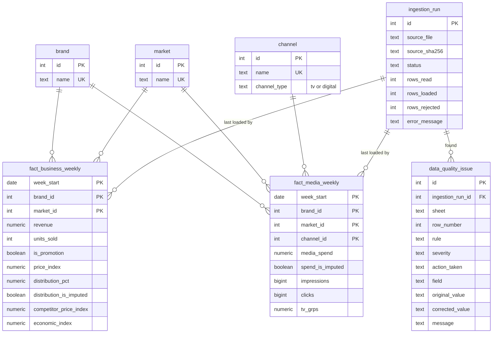

# Marketing Performance Explorer

A web application for exploring marketing performance by brand, market, channel and time period, and for investigating why revenue changed between two periods. Built for the Zephyr Insight full stack assessment, using a synthetic Adclaro dataset.

**Stack note:** the brief names Python. The hiring manager approved using another language by email, so this is built in TypeScript on Node 24.

| Document | Contents |
|---|---|
| [docs/DECISIONS.md](docs/DECISIONS.md) | What was built, the database design, what was left out and why |
| [docs/AI_USAGE.md](docs/AI_USAGE.md) | How AI was used and how the work was checked |

## What it does

- **Overview:** filters for date, brand, market and channel; KPIs for revenue, units, media spend, ROAS, and digital CPC and CTR; weekly trends; a channel comparison; and CSV export of the filtered view.
- **Compare periods:** two chosen periods side by side, with the revenue change shown next to likely drivers. This is labelled as correlation, not causation.
- **Data quality:** the latest ingestion run and every issue it found, with the spreadsheet row, rule, action taken and original value.

## Quick start

### 1. Install the prerequisites

| Tool | Version | Get it |
|---|---|---|
| Git | any | https://git-scm.com/downloads |
| Node.js | 24 or newer | https://nodejs.org |
| pnpm | 11 | Run `corepack enable` once after installing Node. It picks up the exact pnpm version pinned in `package.json`. |
| Docker | Docker Desktop, or Docker Engine with Compose v2 | https://docs.docker.com/get-docker/ |

Check them:

```bash
node --version             # v24.x or newer
pnpm --version             # 11.x
docker compose version     # v2.x
```

Docker must be **running** before step 3. Port **5432** (Postgres) and port **3000** (the app) must be free.

### 2. Get the code and install dependencies

```bash
git clone <repository-url>
cd <repository-folder>
cp .env.example .env
pnpm install
```

On Windows PowerShell, use `Copy-Item .env.example .env` instead of `cp`. The `.env.example` values are for local development only, and `.env` is never committed.

### 3. Start the database, create the schema and load the data

```bash
docker compose up -d --wait   # starts Postgres 16 with a dev and a test database
pnpm migrate                  # creates the tables and views
pnpm ingest                   # cleans the sample dataset in docs/ and loads it
```

### 4. Run the app

```bash
pnpm build
pnpm start
```

Open **http://localhost:3000**. Stop it with `Ctrl+C`.

For development with hot reload, run `pnpm dev` instead of `build` and `start`.

### Run the tests

Postgres must be running (step 3). The integration tests use the separate `marketing_test` database and reset it, so your development data is not touched.

```bash
pnpm lint
pnpm typecheck
pnpm test
```

GitHub Actions runs the same checks, plus `pnpm build`, against a Postgres 16 service.

### Coming back later

```bash
docker compose up -d --wait
pnpm start
```

### Stopping and resetting

```bash
docker compose down        # stop Postgres, keep the data
docker compose down -v     # stop Postgres and delete all data
```

After `down -v`, repeat step 3 to rebuild the database.

### Troubleshooting

| Problem | Fix |
|---|---|
| `port is already allocated` on 5432 | Another Postgres is running locally. Stop it, then run `docker compose up -d --wait` again. |
| Password errors after editing `.env` | Postgres keeps the credentials it was first created with. Run `docker compose down -v`, then repeat step 3. |
| `database "marketing_test" does not exist` | The test database is created only when the Docker volume is first made. Run `docker compose down -v`, then repeat step 3. |
| `pnpm: command not found` | Run `corepack enable`, then open a new terminal. |

## How it is structured

```
docs/ dataset (.xlsx) -> src/ingestion -> PostgreSQL -> src/analytics -> src/app
```

| Folder | Responsibility |
|---|---|
| `db/migrations` | Schema, dimension seeds and views, in numbered SQL files |
| `src/ingestion` | The pipeline. `runPipeline.ts` shows every step in order |
| `src/analytics` | All analytical SQL, as parameterized queries |
| `src/app`, `src/components` | Next.js pages and charts |
| `tests/unit`, `tests/integration` | One unit test file per pipeline step; integration tests against real Postgres |

`src/ingestion` and `src/app` never import each other, and pages read the database only through `src/analytics`.

## Database schema



## Key technical decisions

- **Plain SQL through `pg`, not an ORM.** The analytics are SQL first, and every query can be read and run by hand.
- **Media is aggregated before it meets business data.** Revenue is weekly per brand and market, and media has an extra channel level, so a direct join would repeat revenue once per channel.
- **ROAS is blended only.** Revenue has no channel level, so ROAS is hidden when a channel is selected rather than crediting one channel with all sales.
- **CTR and CPC use digital rows only**, selected by `channel_type`, so TV can never enter them.
- **Missing values are estimated openly.** Linear interpolation within the same series, flagged in the database and shown in the UI. Spend is never written as zero.
- **Loads are idempotent and leave a trail.** Facts are upserted in one transaction, and every run is recorded even when it fails.
- **Filters live in the URL.** Pages are server rendered and any view can be shared as a link.

More detail is in [docs/DECISIONS.md](docs/DECISIONS.md).

## Next steps

With more time, in this order:

1. **Confirm the open data questions with the data owner:** the "Yes" promotion row, the currency, and the two estimated values.
2. **Browser tests** for the main journeys with Playwright. The pipeline and SQL are covered by automated tests; the screens were checked by hand.
3. **Login and roles,** using the company's existing sign in, as described in `docs/DECISIONS.md`.
4. **Deployment:** learn the team's cloud setup, then deploy with a managed Postgres, secrets kept out of the code, and monitoring.
5. **Uploading the weekly file from the browser,** so loading new data does not need the command line.
6. **Brand and market comparison views** side by side.
7. **Containerize the app,** so the whole stack starts with one command.
8. **Modelling which channel drives which sales,** once there is at least a year of data.
