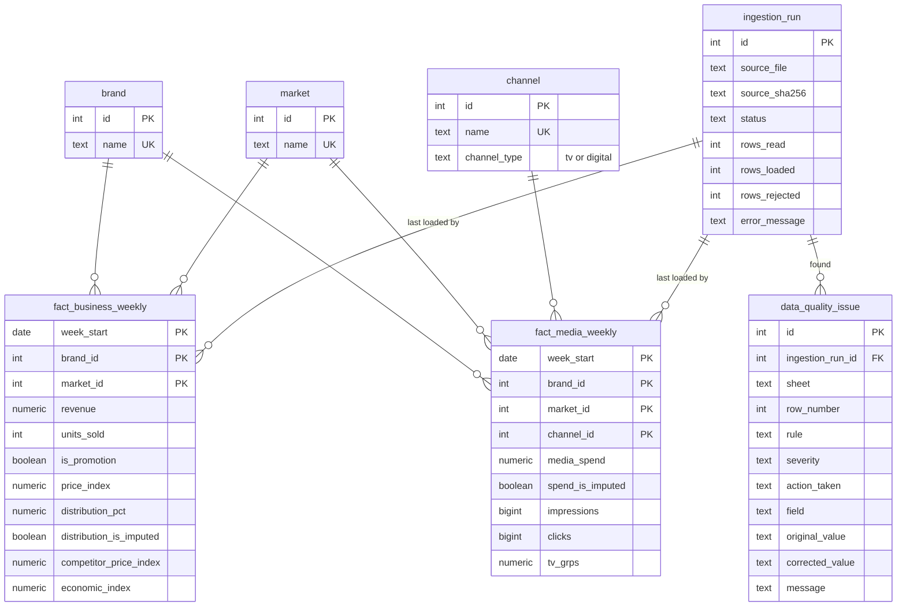

# Marketing Performance Explorer

A web application for exploring marketing performance by brand, market, channel and time period, and for investigating why revenue changed between two periods. Built for the Zephyr Insight full stack assessment, using a synthetic Adclaro dataset.

**Stack note:** the brief names Python. The hiring manager approved using another language by email, so this is built in TypeScript on Node 24.

| Document | Contents |
|---|---|
| [docs/DECISIONS.md](docs/DECISIONS.md) | What was built, what was left out and why, next steps |
| [docs/AZURE_DEPLOYMENT.md](docs/AZURE_DEPLOYMENT.md) | How this would run on Azure |
| [docs/AI_USAGE.md](docs/AI_USAGE.md) | How AI was used and how the work was checked |

## What it does

- **Overview:** filters for date, brand, market and channel; KPIs for revenue, units, media spend, ROAS, and digital CPC and CTR; weekly trends; a channel comparison; and CSV export of the filtered view.
- **Compare periods:** two chosen periods side by side, with the revenue change shown next to likely drivers. This is labelled as correlation, not causation.
- **Data quality:** the latest ingestion run and every issue it found, with the spreadsheet row, rule, action taken and original value.

## Setup

You need Node 24, pnpm 11 and Docker.

```bash
cp .env.example .env
pnpm install
docker compose up -d --wait   # Postgres 16, with dev and test databases
pnpm migrate                  # create the tables and views
pnpm ingest                   # clean the dataset and load it
```

The `.env.example` values are for local development only. `.env` is not committed.

## Run the app

```bash
pnpm build
pnpm start
```

Open http://localhost:3000. Use `pnpm dev` instead while changing the code.

## Run the tests

Postgres must be running. The integration tests use the separate `marketing_test` database and reset it, so development data is not touched.

```bash
pnpm lint
pnpm typecheck
pnpm test
```

GitHub Actions runs the same checks, plus `pnpm build`, against a Postgres 16 service.

## How it is structured

```
docs/ dataset (.xlsx) -> src/ingestion -> PostgreSQL -> src/analytics -> src/app
```

| Folder | Responsibility |
|---|---|
| `db/migrations` | Schema, dimension seeds and views, in numbered SQL files |
| `src/ingestion` | The pipeline. `runPipeline.ts` shows every step in order |
| `src/analytics` | All analytical SQL, as parameterized queries |
| `src/app`, `src/components` | Next.js pages and charts |
| `tests/unit`, `tests/integration` | One unit test file per pipeline step; integration tests against real Postgres |

`src/ingestion` and `src/app` never import each other, and pages read the database only through `src/analytics`.

## Database schema



## Key technical decisions

- **Plain SQL through `pg`, not an ORM.** The analytics are SQL first, and every query can be read and run by hand.
- **Media is aggregated before it meets business data.** Revenue is weekly per brand and market, and media has an extra channel level, so a direct join would repeat revenue once per channel.
- **ROAS is blended only.** Revenue has no channel level, so ROAS is hidden when a channel is selected rather than crediting one channel with all sales.
- **CTR and CPC use digital rows only**, selected by `channel_type`, so TV can never enter them.
- **Missing values are estimated openly.** Linear interpolation within the same series, flagged in the database and shown in the UI. Spend is never written as zero.
- **Loads are idempotent and leave a trail.** Facts are upserted in one transaction, and every run is recorded even when it fails.
- **Filters live in the URL.** Pages are server rendered and any view can be shared as a link.

More detail, including limitations, is in [docs/DECISIONS.md](docs/DECISIONS.md).
