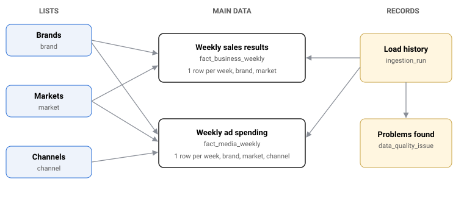

# Priorities and decisions

The brief says a small app that is well built and well explained is better than a big one full of features. So my priority was simple: the numbers have to be right first. The screens came second.

## What I built

1. **A process that loads the spreadsheet into the database.** It reads the file, checks every row, fixes the mistakes it can fix, removes duplicates and saves everything into PostgreSQL. You can run it again whenever a new file comes in. Every problem it finds is written down, with the row it came from.
2. **A database designed around the data.** Brands, markets and channels each have their own small table. Sales results and ad spending are kept in two separate tables. The database also refuses bad values on its own, and it keeps a record of every load and every problem found.
3. **The calculations, written in SQL.** Every number on the dashboard is tested twice: once against a direct database query, and once against figures calculated separately from the original spreadsheet.
4. **A three page app:**
    - **Overview:** the main numbers, charts over time and a breakdown by channel.
    - **Compare periods:** puts two time periods side by side and shows what changed.
    - **Data quality:** lists every problem found in the file and what was done about it.
    - **Download:** any filtered view can be saved as a CSV file.
5. **Automated checks:** 145 tests, plus checks for code style and type errors. They all pass on my machine. They are also set up to run automatically on GitHub, but that has not run yet because the code has not been pushed.

## Database design

The database has three kinds of tables: lists, the main data, and records of every load.

| Table | What it holds |
|---|---|
| **Brands, Markets, Channels** | The short lists of allowed names. Every other table points to these, so a name like "Paid Search" is stored once and can never be misspelled. |
| **Weekly sales results** | Revenue, units sold, promotions, prices and distribution. One row per week, brand and market. |
| **Weekly ad spending** | Spend, impressions, clicks and TV ratings. One row per week, brand, market and channel. |
| **Load history** | One row for every time data is loaded: which file, when, whether it worked, and how many rows were loaded or rejected. |
| **Problems found** | Every problem from every load: the sheet, the row, what was wrong, what was done, and the value before and after. |

**Why sales and ad spending are in separate tables:** each week has one sales figure, but three ad spending rows, one for each channel. In one table, the sales figure would be copied onto all three rows, and adding it up would show three times the real sales.

**The database protects itself.** Even if the code had a bug, the database would still refuse bad data:

- No negative spend, sales or clicks.
- No week can appear twice for the same brand, market and channel.
- Every week must start on a Monday.
- Clicks can never be more than impressions.
- Price and other indexes must be between 50 and 200.
- Ad spend can never be empty. A missing value is either filled in and marked as an estimate, or the row is rejected.

Every estimated value has a yes or no marker next to it, so the app always knows which numbers are real and which are filled in.

## What I left out, and why

| Left out | Why |
|---|---|
| Spotting unusual movements automatically | Less important than the core features, and with only 8 weeks of data there is not enough history to say what "unusual" looks like. |
| Login and access control | Not needed for reviewing an app that runs on your own computer with made up data. How I would add it is explained in the next section. |
| Uploading files from the browser | Loading data is done with one command. A browser upload would add security and error handling work without helping anyone explore the data. |
| Azure deployment plan | I have not worked with Azure. I would rather not present a plan I cannot stand behind. I would want to learn it properly, ideally on the team's existing setup, before proposing one. |
| Running the app itself in Docker | Docker runs the database. The app runs directly on Node, which keeps the setup short. |

## How I would add login

I did not build a login, but this is how I would add one before any real client data goes in.

- **Sign in with the company's existing accounts.** Staff would log in with the account they already use at work, for example Microsoft, Okta or Google. The app would never store passwords.
- **Two step verification** would be handled by that same login provider, following the company's own rules.
- **Two types of user:**
    - **Viewer:** can look at the dashboards and download data.
    - **Operator:** can do everything a viewer can, and can also load new data.
- **The app can only read the data, never change it.** Only the loading process can write to the database. So even if something goes wrong in the app, the data stays safe.
- **Sessions expire.** Logins time out, users can sign out, and every page checks the login on the server, not just in the browser.
- **A record of who did what.** Every data load is already recorded with the exact file it came from. With login in place, it would also record who started it.

## How I handled the problems in the data

### The five mistakes hidden in the file

| Problem | Where | What I did |
|---|---|---|
| The promotion column says "Yes" instead of 1 or 0 | Business sheet, row 22 | Treated it as a yes |
| The distribution value is empty | Business sheet, row 21 | Filled it with 95, the middle point between the week before and the week after, and marked it as an estimate |
| A row appears twice | Media sheet, row 98, a copy of row 19 | Removed the copy |
| "paid search" is written in lower case | Media sheet, row 42 | Changed it to "Paid Search" to match the others |
| The ad spend value is empty | Media sheet, row 82 | Filled it with 1846.8 from the weeks before and after, and marked it as an estimate |

**My rule: nothing gets fixed silently.** Every change is written down with the old value and the new one, and it is shown on the Data quality page, so anyone can check what I changed and why.

### Rules for any future file

- **Unknown names are rejected.** If a brand, market or channel is not on the known list, that row is not loaded.
- **Impossible values are rejected.** For example negative numbers, or index values outside the 50 to 200 range I set.
- **If the same row appears twice with different numbers,** I keep the first one and flag it as an error, because there is no way to know which one is right.
- **Missing weeks are reported, never made up.**
- **A missing value at the very start or end of the data is not filled in.** There is nothing on one side to estimate from, so filling it would just be a guess.
- **Loading a new file replaces the old data.** Rows that are no longer in the file are removed. To protect against a broken file, the load stops completely if a sheet has no usable rows at all.

## Decisions about the numbers

- **Return on ad spend is only shown as a total, not per channel.** The file shows spend per channel, but not which channel brought in the sales. Any per channel figure would be a guess.
- **Periods are compared per week,** so periods of different lengths can still be compared fairly.
- **The Compare page shows what changed together, not what caused it.** With this little data, there is no way to prove what caused what.
- **Sales and ad spend have separate charts.** Putting them on one chart with two scales can make them look more connected than they are.

## Technical choices

- **I wrote the database queries by hand instead of using a library that writes them for me.** It is more work, but nothing is hidden, so I can walk through every query.
- **I kept the database simple.** My first design had one big combined view of all the data. It could not work, because filtering by channel changes which ad spend rows should count. So each query adds up the spend first and only then combines it with sales.
- **No extra indexes.** The tables are already organized by week, which makes the date filters fast. With only 128 rows, more indexes would not make any difference.
- **Rows are saved one at a time.** Simple and fast enough for a file this size. A much bigger file would need a faster bulk load.
- **Filters use a plain form with an Apply button.** It needs almost no code in the browser, and every filtered view has its own link you can share. The cost is that results update when you press Apply, not instantly.
- **TypeScript 6, not 7,** because the code checking tool I use does not support 7 yet.
- **The spreadsheet reading library is installed directly from its maker,** because the version on the usual package site is old and has known security problems.
